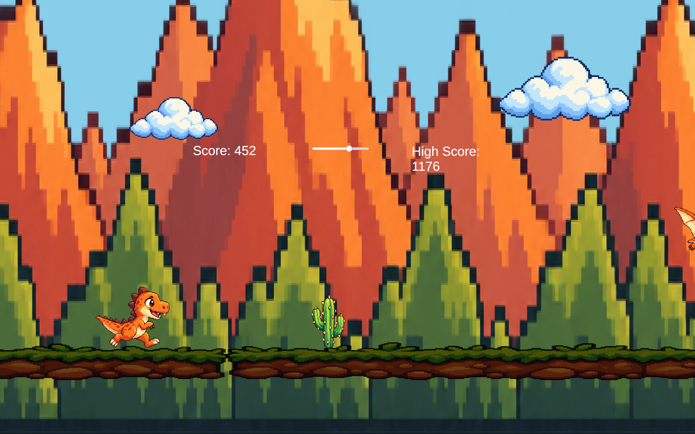
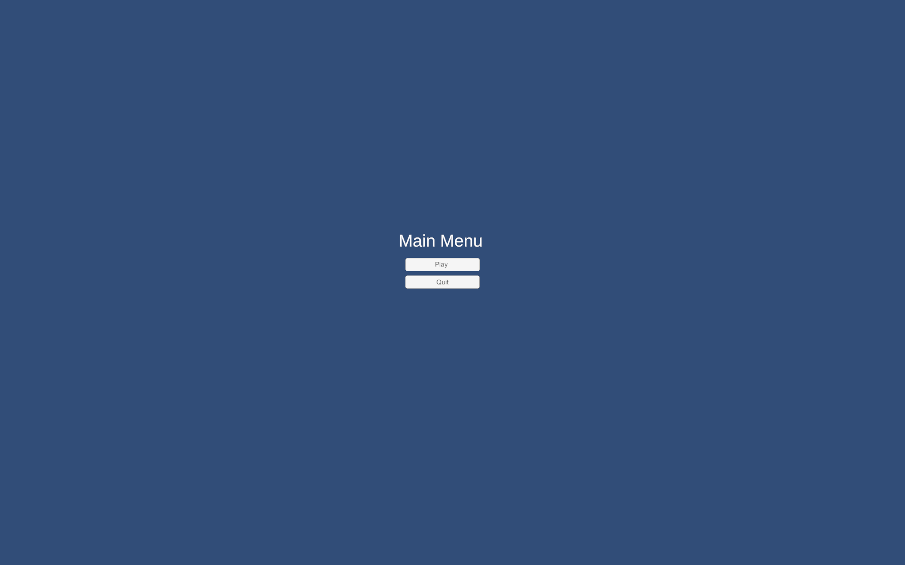
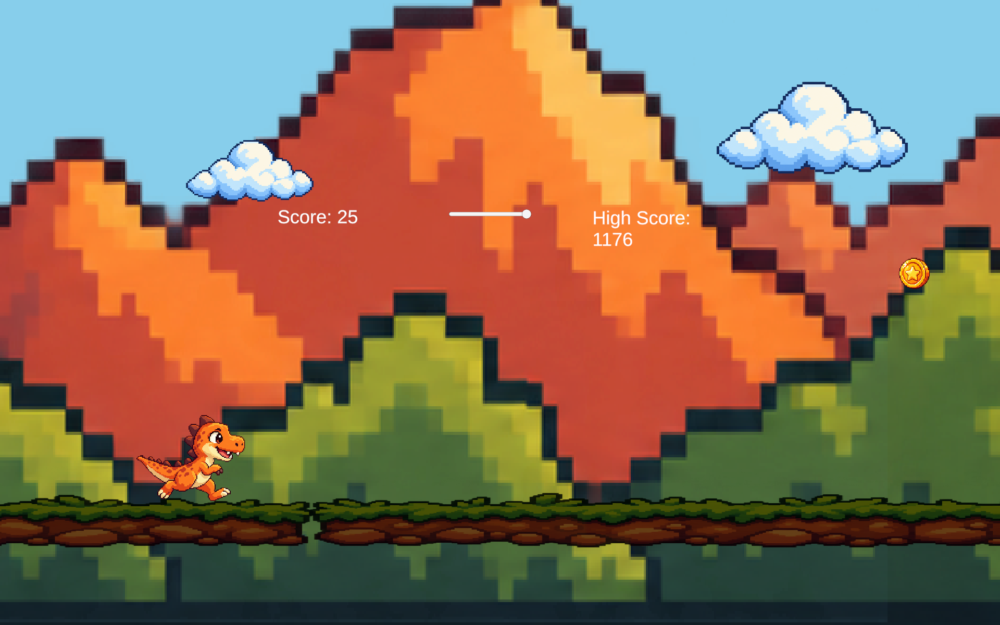
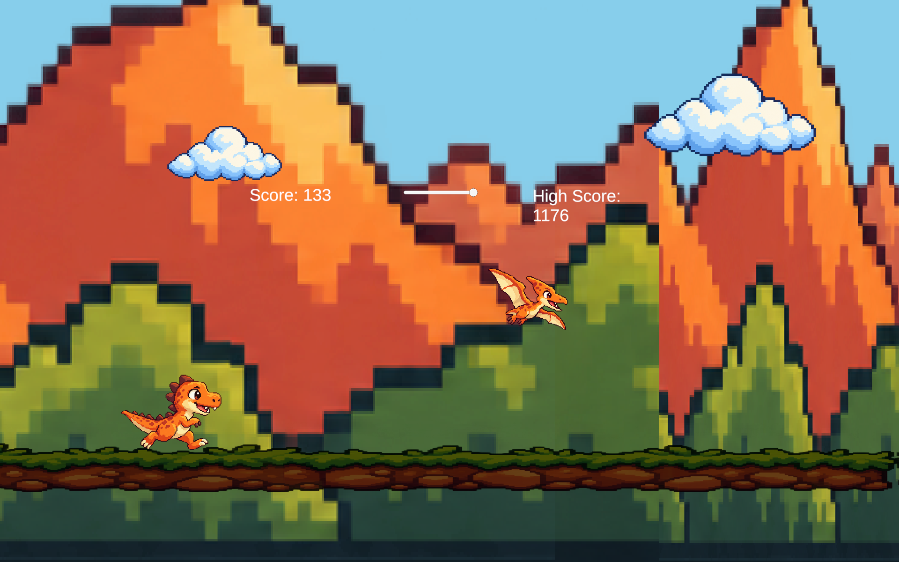
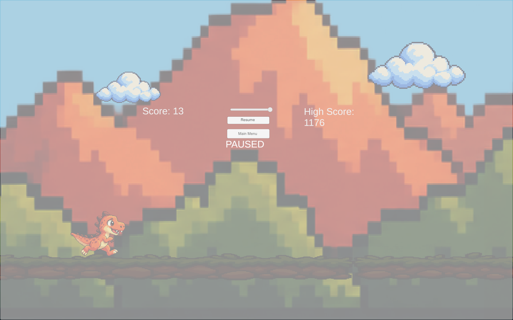
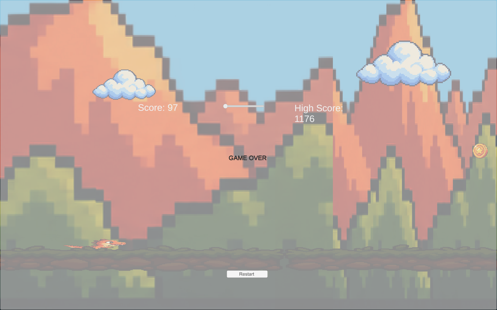

# 🦖 ChromeDino

### A 2D Pixel-Art Endless Runner built with Unity & C#

**ChromeDino** is a colorful take on the classic Chrome dinosaur game. The dinosaur stays near the left side of the screen while obstacles, collectibles, and the environment scroll toward it. Jump over cacti, avoid flying enemies, collect coins, and beat your high score!

> **معرفی کوتاه:** این پروژه یک بازی دوبعدی از نوع دویدن بی‌پایان (Endless Runner) است که با Unity و زبان C# ساخته شده است. بازی شامل پرش، حرکت سریع، موانع زمینی و هوایی، سکه، سیستم جان، رکورد، انیمیشن و منوهای مختلف است.

<p align="center">
  
</p>

## ✨ Features

- **Endless-runner gameplay:** scrolling ground and parallax mountain background.
- **Keyboard controls:** jump with Space, speed boost (dash) with Left Shift, and pause with Escape.
- **Different obstacles:** ground cacti and flying enemies, spawned at varying intervals.
- **Collectible coins:** gain bonus points by collecting score items.
- **Health system:** start with **3 lives**, lose health after collisions, and receive a brief invulnerability period after taking damage.
- **Score & high score:** score grows over time, and the high score is saved locally using `PlayerPrefs`.
- **Character states:** `Run`, `Jump`, `Hit`, and `Death` managed by Unity's Animator.
- **Game flow:** Main Menu, Pause / Resume, Game Over, Restart, and Quit.
- **Custom visuals:** coordinated pixel-art dinosaur, cactus, flying creature, coins, clouds, mountains, and ground.

## 🎮 Controls

| Key | Action |
| :---: | --- |
| `Space` | Jump |
| `Left Shift` | Dash / temporary speed boost |
| `Esc` | Pause / resume the game |
| Mouse | Click menu and restart buttons |

**Goal:** survive as long as possible, dodge obstacles, collect coins, and set a new high score.

## 📸 Screenshots

| Main Menu | Collecting Coins |
| --- | --- |
|  |  |

| Flying Obstacle | Ground Obstacle |
| --- | --- |
|  |  |

| Pause Menu | Game Over |
| --- | --- |
|  |  |

## 🛠️ Built With

- **Unity 6** — 2D game engine
- **C#** — gameplay and game-state logic
- **Unity New Input System** — keyboard actions
- **Rigidbody2D & 2D Colliders** — jumping and collisions
- **Animator** — player animation states
- **TextMeshPro & Unity UI** — score, health bar, and menus
- **PlayerPrefs** — persistent high-score storage

## 🧩 Implementation Overview

The project separates the main gameplay responsibilities into reusable scripts:

| Component / Script | Responsibility |
| --- | --- |
| `PlayerController` | Jump, dash, health, damage handling, and animation triggers |
| `GameManager` | Global game speed, score, high score, health UI, pause, game over, and restart |
| `SpawnManager` | Spawning ground obstacles, flying obstacles, and score items |
| `Interactable` | Common base behavior for interactable objects |
| `GroundObstacle`, `FlyingObstacle`, `ScoreItem` | Obstacle damage and score-item interactions |
| `MoveLeft` | Moving spawned objects from right to left |
| `GroundLoop` | Repeating ground segments for endless scrolling |
| `ParallaxLoop` | Slower-moving background layers for depth |
| `MainMenu` | Starting the game and quitting |

The game uses two Unity scenes: **`MainMenu`** for the start screen and **`Game`** for gameplay.

## 📁 Project Structure

```text
ChromeDino/
├── Assets/
│   ├── Animations/
│   ├── Input/
│   ├── Prefabs/
│   ├── Scenes/
│   │   ├── MainMenu.unity
│   │   └── Game.unity
│   ├── Scripts/
│   └── Sprites/
├── Packages/
├── ProjectSettings/
├── docs/
│   └── screenshots/
└── README.md
```

*The directory tree above shows the main project folders; Unity may create additional local files and folders while opening the project.*

## ▶️ How to Run

1. Clone or download this repository.
2. Open **Unity Hub** and choose **Add project from disk**.
3. Select the `ChromeDino` project folder (the folder containing `Assets`, `Packages`, and `ProjectSettings`).
4. Open it with a compatible **Unity 6** editor.
5. Open `Assets/Scenes/MainMenu.unity` and press **Play**.
6. In the Main Menu, click **Play** to start the game.

### Build for Windows

1. Open **File → Build Profiles**.
2. Select the **Windows** build profile.
3. In the **Scene List**, make sure these scenes are enabled and ordered as:
   - `0 — MainMenu`
   - `1 — Game`
4. Click **Build** and choose a destination folder outside `Assets`.
5. To distribute the build, keep the `.exe` **together with** its generated data and supporting files.

> Unity's generated `Library`, `Temp`, and `Builds` directories generally should not be committed to Git; use a Unity `.gitignore` for them.

## 👩‍💻 Project Information

- **Developer:** Mahya Moeini 

---

<p align="center"><strong>Made with Unity & C# 🦖</strong></p>
